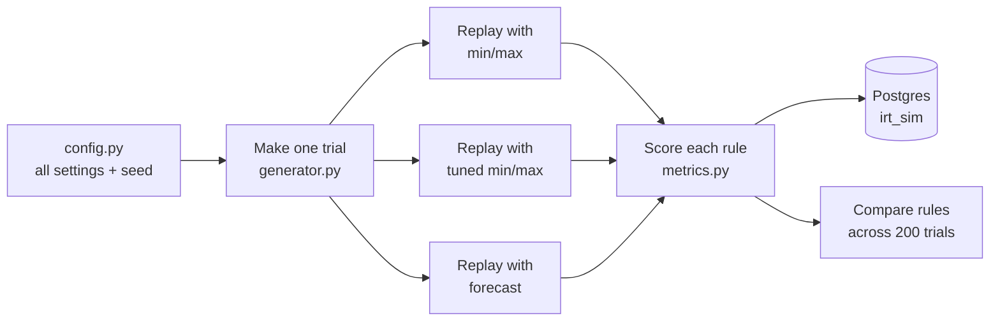

# How it works

Plain-English guide to what this project does and how. For the exact numbers behind each
step, see `docs/assumptions.md`. For how to run things, see `docs/workflow.md`.

---

## Methods at a glance

| Method | Status | Where | What it does here |
|---|---|---|---|
| **Gamma-Poisson enrollment model** | Built | Trial generator (`sim/generator.py`), section 3 | Gives each site its own enrollment pace (Gamma: many slow sites, a few fast) and random weekly patient counts around that pace (Poisson). The standard model in published clinical enrollment forecasting. |
| **Monte Carlo simulation** | Built | Runner (`sim/run.py`), sections 2, 6–8 | Runs 200 random trials per scenario and replays each under every reorder rule. Results are averages and 95% ranges across those trials. This is how every rule, including ML, is tested. |
| Min/max reorder rules | Built | `sim/policies/minmax.py`, `minmax_tuned.py`, section 5 | Fixed reorder trigger and refill level (plain arithmetic). |
| Rolling-average forecast rule | Built | `sim/policies/forecast.py`, section 5 | Recent average use + standard safety-stock formula (plain arithmetic). |
| Schedule-based forecast rule | Built | `sim/policies/schedule.py`, section 5 | Known visit dates of patients on treatment + spare kits for new patients (plain arithmetic). The baseline ML must beat. |
| **Gradient-boosted trees (LightGBM)** | Built | `sim/ml.py`, `sim/train_ml.py`, `sim/policies/ml.py`, section 5 | Machine-learning forecast of weekly kit need, used inside a reorder rule and tested with the same Monte Carlo runs. |

Monte Carlo and ML are not alternatives: Monte Carlo is the test track, and each reorder rule
(including the ML one) is a driver tested on it.

---

## 1. The question

A clinical trial ships drug kits from a depot to sites. Send too few and a patient arrives
with no kit (a **stockout**). Send too many and kits sit on the shelf until they **expire**.

We compare different **reorder rules** — the rule that decides, each week, whether to
ship kits to a site and how many — and ask:

> Under the same trials, which rule gives fewer stockouts, less waste, and fewer shipments?

Everything is made up (synthetic). The point is to compare rules fairly, not to predict
any real trial.

---

## 2. The big picture



1. **Make a trial.** Invent sites, patients, and visits.
2. **Replay it under each rule.** Same patients, same visits, only the shipping decisions differ.
3. **Score each rule.** Count stockouts, expired kits, shipments, stock on hand.
4. **Repeat 200 times** with different random trials.
5. **Compare.** For each trial, take rule B's score minus rule A's score, then average.

Because every rule faces the exact same trials, any difference comes from the rule, not
from one rule getting an easier trial.

### Is this a Monte Carlo simulation?
Yes. "Monte Carlo" just means: run the same experiment many times with random inputs, then
look at the average and the spread of the outcomes. Here, one experiment = one made-up trial
replayed under each rule. We run 200 of them per scenario. The 95% ranges in the results come
from how much the outcome varies across those 200 trials.

### Is this machine learning?
One rule is. Four rules are plain arithmetic: comparing counts to fixed numbers (min/max), an
average of recent weeks plus a standard safety-stock formula (forecast), or known visits plus
spare kits (schedule). "Tuning" min/max means trying 80 combinations and keeping the best one;
nothing is trained. The fifth rule (ML) uses a LightGBM model trained on separate made-up
trials to predict how many kits each site will need (Rule 5 in section 5).

---

## 3. Making a trial (`sim/generator.py`)

### Sites, countries, regions
78 sites in 10 countries in 3 regions (North America, Europe, Asia-Pacific).

### When sites open
- Each **country** gets an approval week (somewhere in weeks 4–30).
- Each **site** opens some weeks after its country is approved (6 weeks on average; a few
  open very late).

### How fast sites enroll
Each site gets its own life story:

| Stage | What happens |
|---|---|
| Startup | Site opens and enrolls slowly; pace climbs over its first 12 weeks. |
| Auto pilot | Site settles at its own steady pace. Most sites are slow, a few are fast. |
| Stumbling | About 1 in 6 sites never really gets going (pace cut to 10%). |
| Stop | Everyone stops enrolling once the trial reaches 500 patients. |

Week to week, enrollment at a site is random around its pace — a site averaging one
patient a month will see some months with 0 and some with 2 or 3.

*How:* a site's steady pace is drawn from a Gamma distribution (gives many slow sites and a
long tail of fast ones). Weekly counts are drawn from a Poisson distribution (the standard
model for random arrivals).

### Patients and visits
- Each patient is randomly assigned to arm A or B (50/50). Each arm has its own kit.
- A patient gets 1 kit at enrollment and 1 kit every 4 weeks after.
- Patients stop treatment at random (half stop within 40 weeks) or at the 104-week maximum.

### Result
On average enrollment takes about 92 weeks, the cumulative curve is S-shaped (slow start,
steady middle, flat end), the top 20% of sites enroll about half the patients, and about
15% of sites enroll nobody.

---

## 4. Supplying the sites (`sim/network.py`)

### Kits and lots
- One central depot with unlimited stock.
- A new lot of each arm's kit is released every 6 months. Each lot expires 24 months after
  it was made. The depot always ships the newest lot.
- A site will not hand out a kit that expires before the patient's next visit (4 weeks).
  Such kits are removed and counted as **expired**.

### Shipping time
North America 1 week, Europe 2 weeks, Asia-Pacific 3 weeks. Fixed.

### What happens every week, at every site, for each arm

1. **Receive** any shipment due this week.
2. **Remove** kits that would expire before the next visit (counted as expired).
3. **Hand out** kits to this week's visits, earliest expiry first. If there are not enough,
   the gap is counted as **kits short** (a stockout). The visit still happens — we do not
   delay or drop the patient, so every rule faces the same demand.
4. **Ask the reorder rule** how many kits to send. They arrive after the region's shipping time.

The rule starts working one shipping-time before the site opens, so the first box lands on
opening day. It stops once enrollment is closed and the site has nobody left on treatment.

---

## 5. The reorder rules (`sim/policies/`)

A **reorder rule** decides, once a week, for each site and each arm: ship kits or not, and
how many. That is the only thing that differs between the runs of a trial (one run per rule).

### What every rule can see (and cannot)

The simulator hands every rule the same bundle of facts each week (called `known` in the
code). Each rule uses only the parts it needs.

| Can see (this week and earlier) | Used by | Cannot see |
|---|---|---|
| Kits on hand, kits in transit | all rules | Any future week's actual demand |
| Kits the site needed each week so far | forecast | Who will enroll next |
| Patients enrolled at the site each week so far | schedule | Which patients will stop early |
| Upcoming visit dates of patients on treatment *now* (assuming they all keep going) | schedule | Which sites will stumble or surge |
| Shipping time, region, arm, weeks since opening, enrollment open or closed | all / some | |

The visit schedule counts as known because a real system knows when each enrolled patient's
next visit is due. What it cannot know is who will drop out, so the rule assumes everyone
keeps going.

Two tests check that no rule peeks ahead: erase everything after week 60 (future visits,
future patients, future end dates) and confirm that no decision before week 60 changes.

**Stock position** = on hand + in transit. All rules work from this number, so a box already
on the way is never ordered twice.

Every rule returns two numbers: how many kits to order, and its **target stock** (the stock
position it is aiming for). The target is saved each week for the dashboard.

### Current settings at a glance

| Rule | Code | Settings (`sim/config.py`) |
|---|---|---|
| Min/max | `minmax.py` | MIN 2, MAX 5, every site |
| Tuned min/max | `minmax_tuned.py` | North America 4/5, Europe 6/8, Asia-Pacific 10/15 (`MINMAX_TUNED`) |
| Forecast | `forecast.py` | Look back 8 weeks, cushion 1.65, floor 2 while enrolling |
| Schedule | `schedule.py` | Visits due in next (shipping + 1) weeks, + spare kits for new patients (cushion 1.65, at least 2 while enrolling) |
| ML | `ml.py` | LightGBM-predicted need over next (shipping + 1) weeks, same spare-kit logic as Schedule (`ML_PARAMS`) |

All rules also follow two shared rules from the supply side (section 4): start one shipping
time before the site opens, and stop once enrollment is closed and the site has nobody on
treatment.

### Rule 1: Min/max

**In words:** if stock position is at or below MIN, order enough to bring it back to MAX.
Otherwise do nothing.

**Example** (MIN 2, MAX 5):

| Week | On hand | In transit | Position | Decision |
|---|---|---|---|---|
| 10 | 4 | 0 | 4 | 4 > 2, no order |
| 11 | 3 | 0 | 3 | 3 > 2, no order |
| 12 | 2 | 0 | 2 | 2 <= 2, order 5 - 2 = **3** |
| 13 | 1 | 3 | 4 | 4 > 2, no order (box already on the way) |

**Strength:** simple, predictable, ships in batches.
**Weakness:** the same two numbers everywhere. Too low for a busy site far from the depot
(runs out while waiting for a box), too high for a slow site (kits sit until they expire).

### Rule 2: Tuned min/max

**In words:** exactly Rule 1, but each region has its own MIN and MAX.

| Region | Shipping time | MIN | MAX |
|---|---|---|---|
| North America | 1 week | 4 | 5 |
| Europe | 2 weeks | 6 | 8 |
| Asia-Pacific | 3 weeks | 10 | 15 |

**How the numbers were picked** (`sim/tune_minmax.py`):
1. Make 30 practice trials, separate from the 200 scoring trials (otherwise the rule would be
   graded on the same test it studied for).
2. Try every MIN from 1 to 10, with MAX from MIN+1 to MIN+8 (80 combinations).
3. For each region, keep combinations that ran short no more often than the forecast rule.
4. Of those, pick the one with the fewest expired kits (then fewest shipments).
5. Asia-Pacific never matched the forecast rule even at 10/15, so it got the closest one.

**Strength:** fixes most of Rule 1's stockouts.
**Weakness:** still one setting for every site in a region, so a busy site and a dead site get
the same 10-15 kits. That is where its waste comes from.

### Rule 3: Forecast

**In words:** look at how many kits this site needed per week over the last 8 weeks.
Keep enough to last until the next box could arrive, plus a safety cushion. If stock position
is below that target, order the difference.

**The formula:**

```
cover   = shipping weeks + 1        (the +1: next chance to reorder is next week)
average = mean kits needed per week, last 8 weeks
spread  = how much weekly need bounces around (standard deviation), last 8 weeks

target  = average x cover  +  1.65 x spread x sqrt(cover)
          \_____________/     \__________________________/
           expected use         safety cushion (~95% of weeks covered)

while enrollment is open: target is at least 2 (so a new patient can always get a kit)
target is rounded up to a whole kit
order   = target - position, if position < target; otherwise 0
```

**Example:** Asia-Pacific site (3-week shipping), one arm. Kits needed over the last 8 weeks:
1, 0, 0, 1, 1, 0, 0, 1.

| Step | Value |
|---|---|
| cover | 3 + 1 = 4 weeks |
| average | 4 kits / 8 weeks = 0.5 per week |
| spread | 0.5 |
| expected use | 0.5 x 4 = 2.0 |
| cushion | 1.65 x 0.5 x sqrt(4) = 1.65 |
| target | 2.0 + 1.65 = 3.65, rounded up to **4** |
| position | 1 on hand + 1 in transit = 2 |
| order | 4 - 2 = **2 kits** |

A quiet site (nothing needed for 8 weeks) gets target 0, raised to the floor of 2 while
enrollment is open. A busy site's target rises on its own as its use goes up.

**Strength:** each site gets stock matched to its own recent use, so busy sites get more and
quiet sites get little. Far less stock and waste.
**Weakness:** it reorders small amounts almost every week, so it sends many more boxes. It
also only reacts to the past: a sudden jump in need shows up in the average only after it
has happened.

### Rule 4: Schedule-based

**In words:** count the kits already booked: the visits due in the coming weeks for patients
on treatment now. Add spare kits for patients who might enroll. Order the difference.

**The formula:**

```
cover     = shipping weeks + 1                           (same as forecast)
scheduled = kits due in the next `cover` weeks for patients on treatment now
new       = site's new patients per week (last 8 weeks) x arm share (50%) x cover
spare     = new + 1.65 x sqrt(new), but at least 2 while enrolling; 0 once enrollment closes
target    = scheduled + spare, rounded up
order     = target - position, if position < target; otherwise 0
```

**Example:** Europe site (2-week shipping, so cover = 3 weeks), arm A. Patients on treatment
have visits due: 1 kit next week, 0 the week after, 2 the week after that. The site enrolled
2 patients in the last 8 weeks.

| Step | Value |
|---|---|
| scheduled | 1 + 0 + 2 = 3 |
| new | 2 / 8 = 0.25 per week x 50% x 3 weeks = 0.375 |
| spare | 0.375 + 1.65 x sqrt(0.375) = 1.39, raised to the floor of **2** |
| target | 3 + 2 = **5** |
| position | 2 on hand + 1 in transit = 3 |
| order | 5 - 3 = **2 kits** |

**A design lesson worth keeping:** the first version applied the floor of 2 to the *total*
target. A site whose existing patients already needed 3 kits then had no spare kit at all,
so new patients often arrived to an empty shelf (about 18 kits short per trial, twice the
forecast rule). Applying the floor to the *spare* kits fixed it (about 3 kits short). This was
found and fixed on the tuning trials, not the scoring trials.

**Strength:** most demand is known in advance, so it holds the least stock and stops sending
kits to patients who are about to finish (far fewer kits left at the end).
**Weakness:** it assumes every patient keeps going, so it slightly over-orders for patients
who will drop out. It needs patient-level data, which simple min/max does not.

### Rule 5: ML (LightGBM)

**In words:** a machine-learning model predicts how many kits this site and arm will need in
each of the next few weeks. The rule then orders exactly like the schedule rule, but using the
model's prediction instead of a plain count of booked visits.

**What LightGBM is:** "gradient-boosted trees". It builds hundreds of small decision trees
("if scheduled visits next week is 2 and the site enrolled someone in the last month, then...").
Each new tree corrects the mistakes of the ones before. It is the most widely proven ML method
for this kind of demand data: it won the M5 forecasting competition (Walmart retail, mostly
"lumpy" demand of 0s, 1s, and 2s) and is common in commercial demand forecasting.

**What it predicts:** kits needed at a site, for one arm, *h* weeks from now (h = 1 to 8).
One model covers every site, arm, and look-ahead week.

**What it can use** (only facts known at the current week; a test checks this):

| Input | Meaning |
|---|---|
| Scheduled kits in week h, and over the next 8 weeks | Known visits of patients on treatment now |
| Kits needed last week, average over last 4 / 8 / 16 weeks | Recent use at this site and arm |
| Patients enrolled per week, average over last 4 / 8 / 16 weeks; total so far | Recent and overall enrollment at this site |
| Patients on treatment at the site, and in this arm | Current load |
| Share of the trial's 500-patient target reached so far | How close enrollment is to closing |
| Weeks since the site opened; enrollment open or closed | Site and trial stage |
| Shipping time, region, arm, look-ahead week h | Context |

**How it was trained** (`python -m sim.train_ml`):
1. Make 40 training trials, separate from the scoring trials (0-199) and the min/max tuning
   trials (10000+). Base scenario only.
2. For every site, arm, week, and look-ahead week, record the inputs above and what actually
   happened h weeks later. About 6.5 million examples.
3. Train on 32 trials; keep 8 aside. Keep adding trees until the error on those 8 stops
   improving ("early stopping"), so the model learns patterns rather than memorising.
4. Save the model to `models/lgbm_need.txt` (not stored in git; re-create it with step 1).

The model is never retrained for the stress scenarios or dashboard knobs. Like tuned min/max,
it is tested on conditions it was not set up for.

**How it orders:**

```
cover     = shipping weeks + 1
expected  = model's predicted need over the next `cover` weeks
scheduled = kits due for patients on treatment now
booked    = the smaller of expected and scheduled   (lets the model allow for likely dropouts)
new       = expected - booked                       (the model's expected new-patient kits)
spare     = new + 1.65 x sqrt(new), at least 2 while enrolling; 0 once enrollment closes
target    = booked + spare, rounded up
order     = target - position, if position < target; otherwise 0
```

This mirrors the schedule rule on purpose: the only difference is where the forecast comes
from, so any difference in results is down to the model.

**Forecast accuracy** on the 8 held-out training trials (lower is better):

| Method | Poisson deviance |
|---|---|
| LightGBM | **0.16** |
| Scheduled visits only | 0.94 |
| Rolling 8-week average | 0.85 |

Poisson deviance is the standard error measure for count forecasts. LightGBM is far more
accurate as a forecast. Scheduled visits account for 87% of what the model learned (its
"gain"); on top of that it learns corrections: likely dropouts, new patients from enrollment
trends, and the approach of enrollment closing.

**But accuracy is not the goal; stockouts and waste are.** See section 7 for how that turns
into supply results.

**A design fix worth keeping:** the first version kept adding spare kits after enrollment had
closed (from the model's tiny leftover new-patient prediction), which left about 75 extra kits
per trial at sites at the end. The schedule rule adds no spare kits once enrollment closes;
the ML rule was changed to match. Found on tuning trials, not scoring trials.

### Ideas not built (kept for discussion)
- **Fewer, bigger forecast shipments:** only ship when at least N kits are needed.

## 6. Scoring and comparing (`sim/metrics.py`)

Per rule, per trial:

| Score | Meaning |
|---|---|
| Stockout events | Site-arm-weeks where at least one kit was short |
| Kits short | Total kits that should have been handed out but were not available |
| Kits expired | Kits removed because they would expire before the next visit |
| Kits left at end | Kits still at sites or in transit when the simulation ends (week 156) |
| Kits shipped | Total kits sent |
| Shipments | Number of boxes (one per site per week, both arms in one box) |
| Avg kits at sites | Average total stock sitting at all sites, per week |

**Comparing two rules:** for each of the 200 trials, take the difference (forecast minus
min/max). Report the average difference and a 95% range. If the range does not include
zero, the difference is real, not luck of the draw.

---

## 7. Results so far (200 trials, per trial averages)

| | Min/max | Tuned min/max | Forecast | Schedule | ML |
|---|---|---|---|---|---|
| Kits short | 296 | 8.2 | 7.7 | **2.7** | 3.3 |
| Kits expired | 264 | 552 | **107** | 112 | 112 |
| Kits left at end | 555 | 1,099 | 323 | 83 | **82** |
| Kits shipped | 6,450 | 7,570 | 6,350 | 6,120 | **6,119** |
| Shipments | **1,625** | 2,445 | 3,519 | 3,461 | 3,485 |
| Avg kits at sites | 484 | 984 | 296 | 220 | **217** |

Differences vs tuned min/max, with 95% ranges, are printed by `python -m sim.run`.

**What it says:**
- The plain min/max runs short a lot, mostly at busy sites far from the depot.
- Tuned min/max fixes the stockouts by holding much more stock, so it wastes much more.
- The forecast rule matches tuned min/max on stockouts (no real difference) with 70% less
  stock and 80% less waste, but sends 44% more boxes.
- The schedule rule is best on service: about a third of the stockouts of tuned min/max or
  forecast (95% range excludes zero). It also holds the least stock, ships the fewest kits,
  and leaves the fewest kits behind, because it knows which patients are near the end of
  treatment. Its expired kits are about the same as forecast.
- The ML rule lands almost exactly on the schedule rule, but slightly worse on stockouts:
  +0.66 kits short per trial (95% range +0.54 to +0.78), with 1.4% less stock and 0.7% more
  boxes. See "Did ML win?" below.
- All three forecast-type rules send about 40% more boxes than tuned min/max. Which matters
  more, kits or boxes, depends on drug cost vs shipping cost, which this project does not model.

### Did ML win?

**No.** On these trials, the ML rule does not beat the plain-math schedule rule. It is a far
better *forecast* (Poisson deviance 0.16 vs 0.94), but that does not turn into fewer stockouts:

| ML minus schedule | Base | Stall | Surge |
|---|---|---|---|
| Kits short per trial | +0.66 | +0.70 | +1.55 |
| 95% range | +0.54 to +0.78 | +0.57 to +0.84 | +1.33 to +1.77 |
| Avg kits at sites | -3.1 (-1.4%) | -3.1 (-1.3%) | -3.7 (-1.8%) |

Why, in plain terms:
1. **Most demand is already known.** 87% of what the model learned comes from the visit
   schedule, which the schedule rule uses directly. There is little left for ML to add.
2. **Better average, thinner cushion.** The model correctly expects some patients to drop out,
   so it books slightly fewer kits. But when a patient it expected to drop out shows up anyway,
   the site is a kit short. Being right on average is not the same as covering the bad weeks.
3. **Surges hurt it most** (+1.55): it was trained only on normal enrollment and never saw a
   surge, so it under-predicts new patients during one.

What this does and does not show:
- It shows that a schedule-aware rule with a sensible cushion is very hard to beat, and that
  forecast accuracy alone is the wrong yardstick for resupply.
- It does not show ML is useless. ML holds slightly less stock, so a fair verdict compares the
  two at *equal* stock levels. The dashboard's safety-level knob (low / normal / high) will
  show both rules' full trade-off curves, which answers that properly.
- Real enrollment and dropout patterns are messier than our generator. ML could matter more
  there, and less (circular validation, scope section 9).

**Known caveat:** the forecast rule learns from demand made by our own generator, so it may
look better here than it would on messier real-world enrollment. The stress test (section 8)
checks this.

---

## 8. Stress test: surges and stalls

### What
Real enrollment does not follow a smooth pattern. To check that the results above are not
just the forecast rule "knowing" our generator, we hit the same 200 trials with shocks that
no rule was set up for:

| Scenario | What happens |
|---|---|
| Base | Normal trial, no shock (the results in section 7). |
| Surge | 30% of sites suddenly enroll at 3x their pace for 12 weeks. |
| Stall | 30% of sites suddenly enroll nobody for 16 weeks, then carry on. |

### How
- The shock hits all chosen sites in the same week, somewhere between weeks 26 and 70.
- A shocked trial is the base trial with the same seed plus the shock. Sites, opening dates,
  and pace are identical; only enrollment during the shock changes. So "surge trial 7" vs
  "base trial 7" isolates the shock.
- No rule is re-tuned. Tuned min/max keeps its base settings; the forecast rule keeps its formula.

### Results (200 trials per scenario, per trial averages)

| | Scenario | Min/max | Tuned min/max | Forecast | Schedule | ML |
|---|---|---|---|---|---|---|
| Kits short | base | 296 | 8.2 | 7.7 | 2.7 | 3.3 |
| | surge | 344 | 14.1 | 10.6 | 3.8 | 5.4 |
| | stall | 291 | 9.3 | 8.0 | 2.9 | 3.6 |
| Kits expired | base | 264 | 552 | 107 | 112 | 112 |
| | surge | 267 | 556 | 111 | 117 | 116 |
| | stall | 273 | 571 | 109 | 114 | 113 |
| Shipments | base | 1,625 | 2,445 | 3,519 | 3,461 | 3,485 |
| | surge | 1,616 | 2,427 | 3,477 | 3,421 | 3,447 |
| | stall | 1,600 | 2,408 | 3,465 | 3,402 | 3,426 |

At the shocked sites only, during the shock and 8 weeks after:

| | Kits needed | Min/max short | Tuned min/max short | Forecast short | Schedule short |
|---|---|---|---|---|---|
| Surge | 498 | 50.5 | 3.5 | 4.4 | 1.6 |
| Stall | 230 | 6.0 | 0.2 | 0.4 | 0.2 |

### What it says
- **The conclusions from section 7 hold under both shocks.** Forecast and tuned min/max give
  about the same service; forecast uses far less stock and wastes far less; forecast ships
  more boxes.
- In the surge, forecast runs short slightly less than tuned min/max over the whole trial
  (10.6 vs 14.1; the 95% range excludes zero). At the surging sites themselves the two are
  within one kit of each other.
- **These shocks turned out to be mild.** Both well-set rules absorb them. Two reasons:
  1. Most kits go to patients already on treatment (a kit every 4 weeks), and those visits
     are not affected by an enrollment shock. A surge only adds first kits.
  2. Total enrollment is fixed at 500, so a surge just finishes enrollment sooner.
- So this test shows the forecast rule's advantage is not fragile to enrollment shocks of
  this size. It does **not** show how either rule behaves under harsher disruption (bigger or
  longer surges, a surge concentrated in the far region, shipping delays).

---

## 9. Checks that keep it honest (`tests/`)

- Same seed → identical results, every time.
- Stock never goes negative; each week's stock adds up (last week + received − handed out − expired).
- Kits handed out + kits short = kits needed, for every site, arm, and week.
- Shipments arrive exactly one shipping-time after they are sent.
- Every kit shipped ends up handed out, expired, or still on hand / in transit.
- **No peeking:** erase all visits from week 60 on; every decision before week 60 must be unchanged.
- Tuning trials never overlap scoring trials.
- Shocks only touch the chosen sites, only inside the shock window; stalled sites enroll nobody during the stall.
- A shocked trial has the same sites as the base trial with the same seed.
